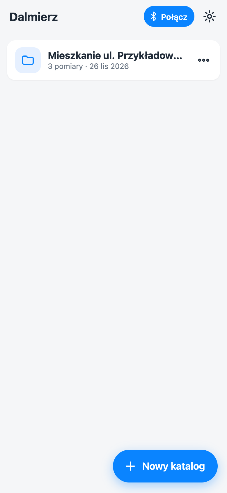
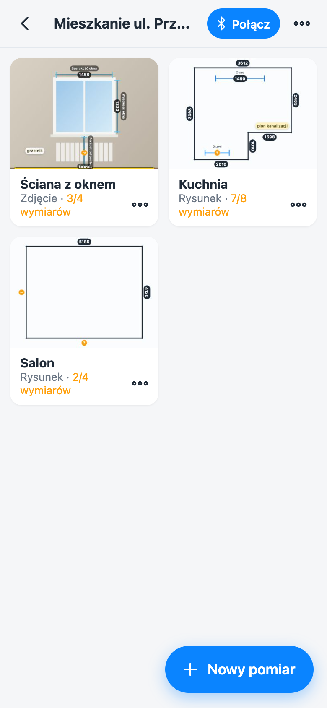
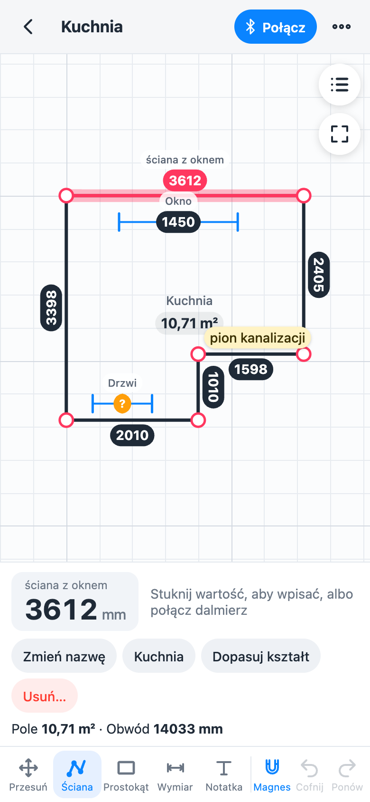
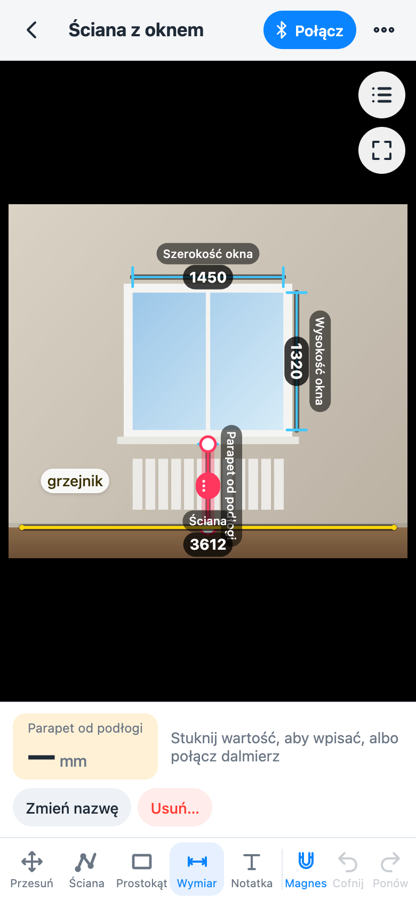

# Dalmierz

Webowa aplikacja (PWA) do mierzenia mieszkań z dalmierzem laserowym **FNIRSI IR40** przez Bluetooth. Działa na iPhonie bez konta deweloperskiego Apple i bez backendu. Wszystkie dane zostają na telefonie.

Do czego: oglądanie mieszkań, kuchnie i meble na wymiar, zbieranie wymiarów pomieszczeń.

**Aplikacja:** https://szymborski.github.io/fnirsi-ir40-web-app/  
**Demo z przykładowymi danymi:** https://szymborski.github.io/fnirsi-ir40-web-app/?demo

| Katalogi | Pomiary | Rysunek | Zdjęcie |
|---|---|---|---|
|  |  |  |  |

## Co umie

- **Katalogi** (np. „Mieszkanie ul. Smocza 16”), a w nich **pomiary** o własnych nazwach („Kuchnia”, „Całe mieszkanie”).
- **Rysunek**: przeciągasz palcem, żeby narysować ścianę. Kolejna ściana zaczyna się od końca poprzedniej, a połączenie z początkiem zamyka pomieszczenie. Magnes przyciąga do punktów, kątów 45°/90° i do linii innych punktów. Jest też prostokąt, linia wymiaru (np. okno, przekątna) i notatki tekstowe.
- **Zdjęcie**: robisz zdjęcie albo bierzesz je z galerii, a potem rysujesz na nim linie wymiarów. Zoom dwoma palcami. Lupa nad palcem pokazuje dokładne miejsce.
- **Pomiar z dalmierza**: zaznaczasz odcinek i naciskasz przycisk na IR40. Wartość wpada do odcinka, a aplikacja sama zaznacza następny niezmierzony. Pokój mierzysz bez dotykania telefonu. Krótki dźwięk potwierdza odczyt.
- Wymiar możesz też wpisać ręcznie (stuknij wartość).
- **Pole i obwód** zamkniętych kształtów. Ostrzeżenie, gdy wymiary się nie domykają (krzywe ściany, błąd pomiaru). Przycisk „Dopasuj kształt” przerysowuje kształt w skali.
- **Eksport PNG** z wymiarami (np. do wysłania stolarzowi).
- **Kopia zapasowa** katalogu lub wszystkiego do pliku `.json` (ze zdjęciami) i import z pliku.
- Jednostki: mm (domyślnie), cm, m.
- Tryb testowy bez dalmierza (symulowane odczyty).

## Czego potrzebujesz

- Dalmierz **FNIRSI IR40** z włączonym Bluetooth.
- **iPhone**: przeglądarka z Web Bluetooth. Safari jej nie ma, Chrome i Edge na iOS też nie (używają silnika Safari).
  - **[Bluefy – Web BLE Browser](https://apps.apple.com/app/bluefy-web-ble-browser/id1492822055)** (polecana): darmowa, ocena 4,8, obsługuje `getDevices()`, więc po pierwszym połączeniu aplikacja łączy się sama.
  - Alternatywa: **[beacio](https://apps.apple.com/app/id6761301368)**, rozszerzenie Safari z Web Bluetooth (iOS 26.2+). Jest nowe i ma mało opinii, więc nie było testowane z tą aplikacją.
- **Komputer**: Chrome lub Edge (macOS, Windows, Android też działa).

## Quickstart

### Na iPhonie

1. Zainstaluj **Bluefy** z App Store.
2. Otwórz w Bluefy https://szymborski.github.io/fnirsi-ir40-web-app/
3. Utwórz katalog, a potem **Nowy pomiar → Rysunek** lub **Zrób zdjęcie**.
4. Stuknij **Połącz** (u góry) i wybierz `fnirsi.etool.40mpro`.
5. Narysuj ściany, stuknij odcinek i mierz przyciskiem na dalmierzu.

Chcesz zobaczyć przykład? Otwórz https://szymborski.github.io/fnirsi-ir40-web-app/?demo. Pojawi się katalog z przykładowymi pomiarami.

### Lokalnie (komputer)

```bash
git clone https://github.com/szymborski/fnirsi-ir40-web-app.git
cd fnirsi-ir40-web-app
python3 dev/serve.py
```

Otwórz `http://localhost:8640/?demo` w Chrome. `localhost` liczy się jako bezpieczny kontekst, więc Bluetooth działa bez HTTPS.

## Przechowywanie danych

- Wszystko jest w **IndexedDB** przeglądarki: katalogi, pomiary i zdjęcia (jako pliki JPEG, przeskalowane do 2560 px, zwykle 0,5–1,5 MB).
- Aplikacja prosi o trwałe przechowywanie (`navigator.storage.persist()`).
- **Ważne:** iOS może usunąć dane strony, której długo nie otwierasz, a usunięcie Bluefy kasuje jej dane. **Rób kopie zapasowe**: ⚙︎ → Kopia zapasowa wszystkiego, potem zapisz plik w Plikach lub iCloud Drive. Import: ⚙︎ → Wczytaj kopię zapasową.
- Dane z Bluefy i z Safari to osobne magazyny. Przenosisz je plikiem kopii.

## Struktura

```
index.html, css/app.css     UI shell
js/app.js                   router, ekrany, eksport, ustawienia
js/editor.js                edytor canvas (gesty, rysowanie, przyciąganie, undo)
js/render.js                rysowanie sceny (edytor, lupa, miniatury, PNG)
js/geometry.js              hit test, snap, pole/obwód z wymiarów
js/ble.js                   klient BLE FNIRSI IR40
js/db.js                    IndexedDB
js/backup.js, js/image.js   kopia zapasowa, import zdjęć
sw.js, manifest.webmanifest offline + ikona na ekranie początkowym
dev/                        serwer lokalny, sniffer BLE (Python), zrzuty ekranu
tests/run.mjs               testy (node tests/run.mjs)
```

Szczegóły protokołu i nieoczywiste problemy: [AGENTS.md](AGENTS.md).

## Podziękowania

Protokół BLE na podstawie [MultiMote/fnirsi-ir40-webtool](https://github.com/MultiMote/fnirsi-ir40-webtool) i [pollopersiano/fnirsi-ir40-cad-bridge](https://github.com/pollopersiano/fnirsi-ir40-cad-bridge), potwierdzony na prawdziwym urządzeniu.
